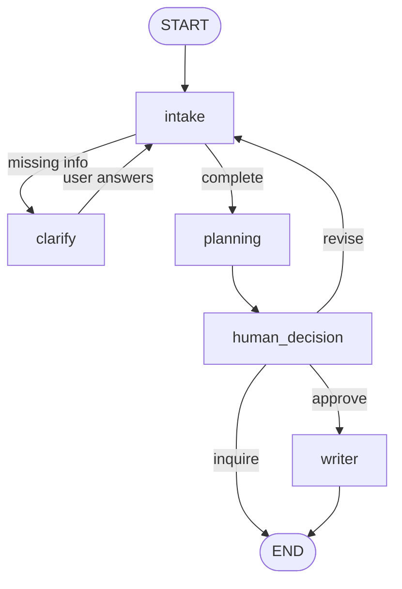

# MCP Trip Planner

A LangGraph pipeline that turns a free-text trip request into a researched travel plan. Every external capability comes from an **MCP server**: live flights (Ignav), destination research (Tavily) and file output (the official filesystem server). A human-in-the-loop step lets you keep the plan, change the request, or approve it and save it as a text file. A Streamlit app and a Jupyter notebook both drive the same graph.

## What it does

1. **Intake**: an LLM reads the conversation and fills a validated Pydantic model (origin, destination, dates, trip type, travellers, budget, interests, nationality, hotel preferences).
2. **Clarify**: if something required is missing (for example an exact date), the graph pauses and asks.
3. **Planning**: one agent resolves airport codes, searches flights, researches hotels, activities, events, visa rules and local transport, and writes a plan with a budget snapshot.
4. **Decision**: you choose to *approve*, *revise* or *inquire*.
5. **Writer**: on approval, a second agent saves the plan as `<destination>.txt` inside a sandbox folder.



## Stack

| Layer | Tools |
|---|---|
| Orchestration | LangGraph (StateGraph, `interrupt`, `Command`, `MemorySaver`) |
| Agents / LLM | LangChain `create_agent`, OpenAI `gpt-4o` (temperature 0) |
| MCP | `langchain.mcp.MCPAdapter` with Ignav, Tavily and `@modelcontextprotocol/server-filesystem` |
| Validation | Pydantic v2 |
| UI | Streamlit |

## MCP servers and tools

| Server | Transport | Tools given to agents | Agent |
|---|---|---|---|
| Ignav | remote, bearer token | `search_airports`, `search_flights` | planning |
| Tavily | remote, key in URL | `tavily_search` | planning |
| Filesystem | local via `npx` | `write_file` (sandbox only) | writer |

Tools are discovered at runtime from the servers. The servers expose more tools than are used; agents only get the ones above, so the planning agent cannot write files and the writer cannot search.

## Project structure

```
.
├── config.py          # env checks, sandbox path, MCP server config
├── schemas.py         # Pydantic models, graph state, small helpers
├── prompts.py         # intake, planning and writer prompts
├── tools.py           # MCP connection handling + LangChain tool wrappers
├── pipeline.py        # graph nodes and build_graph()
├── streamlit_app.py   # Streamlit UI
├── mcp_project.ipynb  # notebook walkthrough
└── travel_plan_file/  # sandbox where plans are saved (created at runtime)
```

## Setup

**Requirements:** Python 3.10+ (developed on 3.13), Node.js (the filesystem MCP server runs through `npx`), and API keys for OpenAI, Tavily and Ignav.

```bash
pip install -r requirements.txt
```

Create a `.env` file next to the code:

```
OPENAI_API_KEY=...
TAVILY_API_KEY=...
IGNAV_API_KEY=...

# optional
TRIP_PLANNER_MODEL=gpt-4o
TRIP_PLANNER_SANDBOX=travel_plan_file
```

Before pushing to GitHub, add a `.gitignore` so keys and generated files stay out of the repo:

```
.env
travel_plan_file/
__pycache__/
.ipynb_checkpoints/
```

## Usage

### Streamlit

```bash
streamlit run streamlit_app.py
```

Describe the trip, answer any follow-up question, review the plan, then press **Approve & save .txt**, **Revise** (type the change first) or **Keep & end**. After saving, a download button appears.

### Notebook

```python
from pipeline import build_graph
from schemas import get_interrupt
from tools import close_mcp
from langgraph.types import Command

graph = build_graph()
cfg = {"configurable": {"thread_id": "trip-1"}}

result = await graph.ainvoke(
    {"question": "Cologne to Lisbon, 2026-11-12 to 2026-11-18, 2 adults, budget 1500 EUR, I like food and history"},
    cfg,
)
get_interrupt(result)            # clarify question, or the plan awaiting your decision

# change your mind
result = await graph.ainvoke(
    Command(resume={"action": "revise", "message": "Add beaches and museums, hotel near the airport"}),
    cfg,
)

# happy with it
result = await graph.ainvoke(Command(resume={"action": "approve"}), cfg)
print(result["saved_filename"])

await close_mcp()                # when you are done
```

Restart the kernel after editing any `.py` file; Jupyter caches imported modules.

### Resume payloads

| Paused at | Resume with |
|---|---|
| Clarify | `{"message": "round trip, departing 2026-11-12"}` |
| Decision | `{"action": "approve"}`, `{"action": "inquire"}` or `{"action": "revise", "message": "..."}` |

Invalid input (empty message, unknown action) re-asks with an `error` key in the interrupt payload instead of raising.

## Design notes

- **Structured intake.** Validators reject non-ISO dates and a return date before departure. Vague dates ("next Friday") stay empty so the graph asks rather than guesses.
- **Source rules in the planning prompt.** Flight data comes only from Ignav, airport codes only from the airport tool, and Tavily is not allowed for flights. Prices are not estimated and currencies are not converted. Visa research is skipped when no nationality is given.
- **Re-ask instead of raise.** A LangGraph node that raises after a resume leaves the thread stuck on the stale resume value. Both interrupt nodes loop and re-interrupt on bad input.
- **One long-lived MCP connection task.** Connections are opened and closed by the same task, which anyio requires, and Streamlit runs the graph on one background event loop so connections survive script reruns.
- **Sandboxed writes.** The write tool resolves the path and refuses anything outside the sandbox folder.
- **Tool errors are logged.** If a tool call fails during planning, a `Tool ... failed:` warning is logged; otherwise only the agent's final answer is kept.

## Limitations

- **Prices and currencies.** Flight prices come back in the currency Ignav returns (USD in the example runs), which can differ from the budget currency. The plan shows both and does not convert. Hotel prices appear only when the search results contain them.
- **Text output only.** Plans are saved as `.txt`; the filesystem write tool writes text, so there is no PDF.
- **In-memory state.** `MemorySaver` loses all threads when the process restarts. After *approve* or *inquire* a thread has ended; start a new thread for a new trip.
- **Not built:** parallel research agents, a budget-analysis revise loop, a database, and a custom MCP server
## Example requests

- `Cologne to Lisbon, 2026-11-12 to 2026-11-18, 2 adults, budget 1500 EUR, I like food and history`
- `I want to travel from Cologne to Mallorca, December 15 2026 to December 25 2026, budget 1500 EUR, I like museums, food, night life and history`, then revise with `I want a hotel near the airport`
